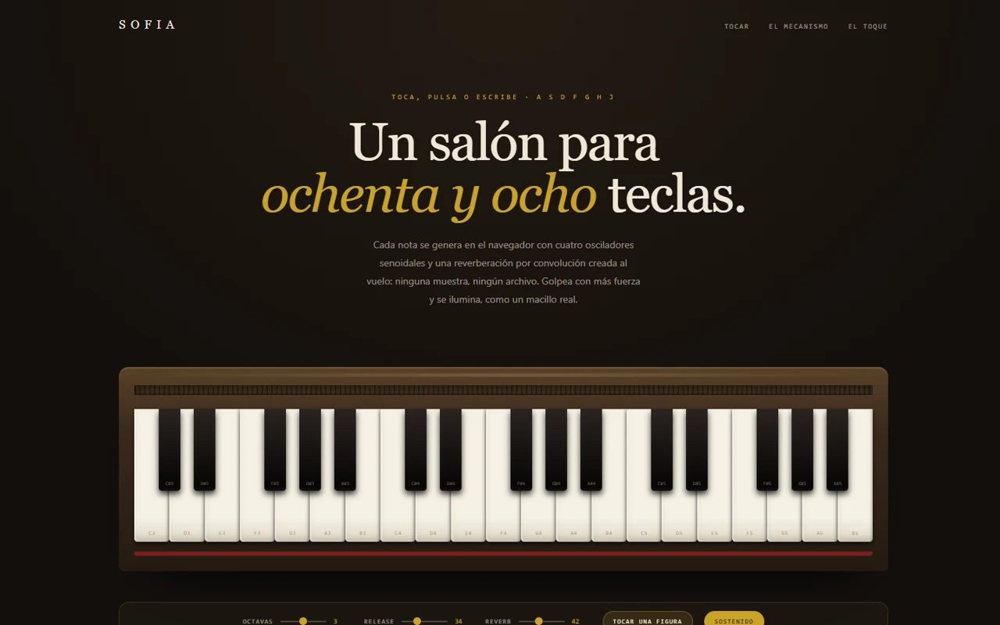

<meta property="og:title" content="SOFIA — PIANO KEYBOARD">
<meta property="og:description" content="Un piano tocable en una sola página HTML: teclas de madera y marfil dibujadas en CSS y notas sintetizadas en directo con Web Audio, sin muestras ni dependencias.">
<meta property="og:image" content="https://raw.githubusercontent.com/Hugopvigo/Piano/main/docs/capturas/00-cabecera.webp">

<p align="center">
  
</p>

<p align="center">
  <b>Un salón de madera oscura con un piano que suena de verdad.</b><br>
  Todo dibujado en CSS y sintetizado en el navegador, en un único fichero HTML.
</p>

<p align="center">
  
  
  
  
</p>

---

## Qué es esto

**SOFIA** es un instrumento de juguete: un piano que se toca con el ratón, con
el dedo o con el teclado del ordenador. La madera del mueble, el marfil de las
teclas, el fieltro rojo y el brillo dorado que sigue a cada golpe están dibujados
con gradientes y sombras CSS. El sonido no es una grabación: cada nota se genera
en el momento con la Web Audio API.

Cabe **todo en un solo `index.html`**: sin CDN, sin fuentes web, sin imágenes
externas, sin librerías y sin muestras de audio. Se abre con doble clic y
funciona sin conexión.

## Cómo se toca

- **Ratón o tacto:** pulsa una tecla y desliza para hacer un glissando.
- **Teclado del ordenador:** fila `A W S E D F T G Y H U J K O L`. Las teclas
  negras están en `W E T Y U O`.
- **Octavas:** de 1 a 5, empezando en C3.
- **Release y Reverb:** duración del soltado y cantidad de reverberación.
- **Sostenido:** al desactivarlo, cada nota se amortigua sola.
- **Tocar una figura:** melodía de demostración a 230 ms por nota; se puede
  detener a mitad.

Las etiquetas de las teclas desaparecen por debajo de 560 px y la columna de
lectura se apila por debajo de 880 px.

## Cómo suena

Cada voz usa cuatro osciladores senoidales (1×, 2×, 3× y 4,2× el fundamental),
cada uno con su ganancia y su caída exponencial: los parciales agudos mueren
antes, y por eso se oye una tecla golpeada y no un zumbido. La envolvente tiene
6 ms de ataque, cae al 35 % en 140 ms y termina con una salida exponencial cuyo
largo marca el control *Release*.

La señal pasa por una ganancia maestra y un compresor antes de llegar al
altavoz y a la sala: una convolución con una respuesta al impulso de 1,8 segundos
generada al vuelo a partir de ruido que decae. El `AudioContext` se crea en la
primera interacción, como exige la política de reproducción del navegador.

## Cómo está hecho

```
.
├── index.html                  todo: HTML, CSS y JavaScript en línea
└── docs/capturas/
    └── 00-cabecera.webp        vista previa (1280×800)
```

El teclado se construye en tiempo de ejecución: cada tecla blanca se coloca por
porcentaje de ancho y cada negra se centra en el límite correspondiente, con el
62 % del ancho y el 62 % de la altura. El mueble, el tablero rayado y el fieltro
son solo CSS; la síntesis y la reverb, solo Web Audio.

## Abrirlo

Con doble clic en `index.html`, o en la versión publicada:
**https://hugopvigo.github.io/Piano/**

## Licencia

Bajo **CC BY-NC-SA 4.0**: compartir con atribución, sin uso comercial y bajo la
misma licencia. Consulta [LICENSE](LICENSE) para el texto completo.
